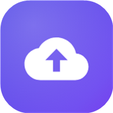
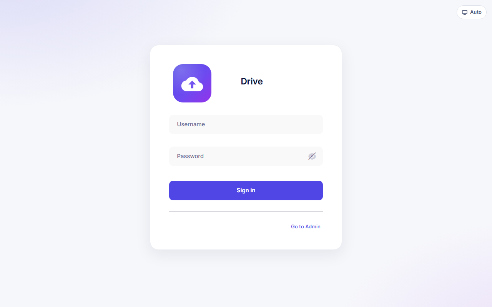
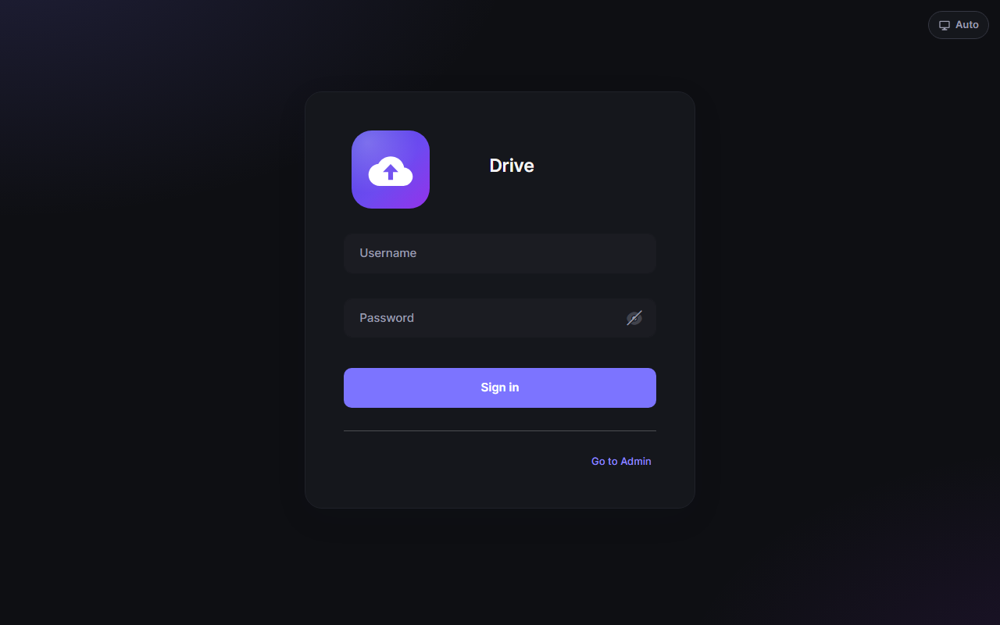
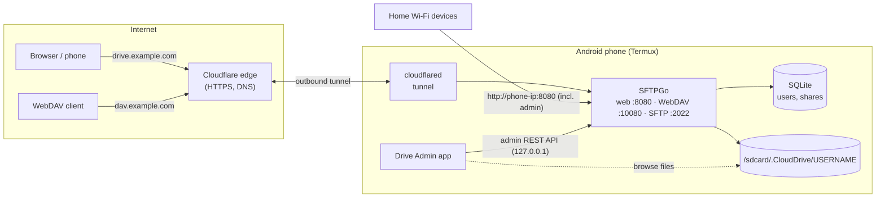

<p align="center">
  
</p>

<h1 align="center">phone-cloud-drive</h1>

<p align="center">
  Turn an old Android phone into a private cloud drive: a web drive, a network drive (WebDAV),
  public HTTPS access through Cloudflare Tunnel, and an Android admin app. No root required.
</p>

<p align="center">
  
  
</p>

---

## Features

**Web drive** (SFTPGo web client with a custom theme)
- Upload, download, rename, move/copy, delete, folders, search, multi-file zip download
- Photo viewer and in-browser video/audio player (incl. m4a, aac, flac, opus, m4v, avif)
- Drop files anywhere on the page to upload; Enter/Escape in "New folder"
- Responsive layout for phones, laptops and desktops; light, dark and auto themes
- Share links with optional password, expiry date and usage limit; single-file shares
  download the original file (not a zip)
- Clear warning instead of a failed upload for files over the 100 MB Cloudflare limit

**Access**
- `https://drive.example.com`: web drive from anywhere (Cloudflare Tunnel, no port forwarding)
- `https://dav.example.com`: map as a network drive (Windows, macOS, Linux, phones)
- SFTP and the admin panel on the home network only

**Security & reliability**
- Each user is locked to their own folder; others only see files through share links
- Logins survive server restarts and phone reboots (persistent signing key), 12 h sessions
  renewed while in use, not tied to one IP (Wi-Fi to mobile data)
- `Secure`/`HttpOnly`/`SameSite=Strict` cookies, HSTS and other security headers
- Brute-force protection using the real visitor IP from Cloudflare
- Admin panel and REST API are never exposed to the internet
- Files kept in a hidden folder with `.nomedia`, so they don't appear in Gallery or media apps
- Auto-start after reboot (Termux:Boot), health-check and "sign out everywhere" commands

**Drive Admin Android app**
- Users, storage limits, access level (full / upload-no-delete / view-only), passwords
- Live connections with disconnect, service status, phone storage
- Per-user file browser with thumbnails; "Save to phone" copies a file to a public folder
- "Stay signed in" with the password encrypted by the Android Keystore

## How it works



More detail: [docs/architecture.md](docs/architecture.md).

## Quick start

You need an Android phone (Android 7+), a computer for the one-time setup, and,
for public access, a domain using Cloudflare DNS (free plan).

1. **Prepare the phone:** install Termux and Termux:Boot (from GitHub or F-Droid), allow
   storage access, and exclude Termux from battery optimisation.
   [docs/setup.md](docs/setup.md#1-prepare-the-phone)
2. **Install the server** inside Termux:
   ```sh
   pkg install -y git
   git clone https://github.com/<owner>/phone-cloud-drive.git
   cd phone-cloud-drive
   bash server/install.sh
   ```
3. **Create the admin account** at `http://<phone-ip>:8080/web/admin` (home Wi-Fi), then add users.
4. **Public HTTPS access (optional):** fill in `server/cloudflared/tunnel.env` and run
   `bash server/cloudflared/setup-tunnel.sh`. See [docs/cloudflare-tunnel.md](docs/cloudflare-tunnel.md).
5. **Admin app (optional):** build and install it, see [docs/android-app.md](docs/android-app.md).

Check everything with `drive-status` in Termux.

## Documentation

| Guide | Contents |
|---|---|
| [Requirements](docs/requirements.md) | Hardware, accounts, tools and versions |
| [Setup](docs/setup.md) | Step-by-step installation on the phone |
| [Cloudflare Tunnel](docs/cloudflare-tunnel.md) | Public HTTPS hostnames, DNS, alerts |
| [Configuration](docs/configuration.md) | Every setting in `drive.env`, ports, paths |
| [Android app](docs/android-app.md) | Build, install and use Drive Admin |
| [Architecture](docs/architecture.md) | Components, data flow, sessions, file layout |
| [Security](docs/security.md) | Threat model, isolation, sessions, known limits |
| [Maintenance](docs/maintenance.md) | Status, logs, upgrades, backups, troubleshooting |

## Repository layout

```
phone-cloud-drive/
├── server/
│   ├── install.sh                 # one-time installer (run in Termux)
│   ├── termux/
│   │   ├── bin/                   # start-drive, start-tunnel, drive-status, drive-signout-all
│   │   ├── boot/00-home-server    # Termux:Boot auto-start script
│   │   └── bashrc.snippet         # start services when Termux is opened
│   ├── sftpgo/
│   │   ├── drive.env.example      # all drive settings (copied to ~/sftpgo-ui/drive.env)
│   │   ├── install-ui.sh          # builds the themed UI from your SFTPGo install
│   │   ├── patches/               # small patches for SFTPGo's own templates
│   │   └── static/drive/          # theme CSS, logo, favicon
│   └── cloudflared/
│       ├── tunnel.env.example     # your hostnames (copy to tunnel.env)
│       ├── setup-tunnel.sh        # creates the tunnel, DNS records and config
│       └── config.yml.example     # what the generated config looks like
├── android/                       # Drive Admin app (Kotlin, Jetpack Compose)
└── docs/                          # guides and images
```

## Limitations

- **First unlock after a reboot.** With a PIN/pattern/password, Android keeps all app data
  encrypted until the phone is unlocked once after power-on, so the server starts about
  15 seconds after that first unlock (opening Termux is not needed). Without a secure
  screen lock it starts on its own.
- **Web sessions max out at 12 hours** of inactivity (an SFTPGo limit).
- **100 MB per upload** through Cloudflare's free plan; larger files upload fine on the home network.
- **One copy of your data.** It lives on the phone; keep backups ([maintenance](docs/maintenance.md#backups)).

## License

MIT for this project's code. SFTPGo, cloudflared, Termux and other components keep their
own licences, and SFTPGo's WebUI templates are patched in place rather than redistributed.
See [NOTICE.md](NOTICE.md).
