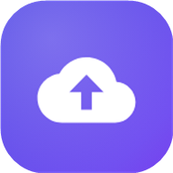

# Drive Admin (Android app)



A small native app (Kotlin, Jetpack Compose, Material 3) to manage the drive from a phone.
It talks to SFTPGo's **admin REST API** on `http://127.0.0.1:8080` (on the server phone) or
`http://<phone-ip>:8080` (another phone on the same Wi-Fi). The admin API is never exposed
through the tunnel, so the app works on the home network only.

## Features

- **Overview:** storage used by all users, active/total users, people online now, phone storage,
  and status of web, WebDAV, SFTP and database
- **Users:** create, enable/disable, delete; storage limit (1/5/10/25/50 GB or none); access level
  (*Full access*, *Upload, no delete*, *View only*); change password; recalculate usage
- **Active connections:** protocol, IP, connected/active time, **Disconnect**
- **File browser** (on the server phone): per-user folders with photo/video thumbnails; **Open** a file
  in another app without making it public; **Save to phone** copies it to `Pictures|Movies|Music|Download/Drive`
  so it appears in Gallery; **Delete**
- **Stay signed in:** the admin password is encrypted with an AES-256-GCM key in the
  **Android Keystore** and used to sign in automatically after the app restarts or the phone
  reboots. Turning the switch off or tapping **Sign out** deletes it. A changed password is detected
  and the saved copy removed.
- Light/dark theme following the system, dynamic colours on Android 12+

## Source layout

```
android/
├── settings.gradle.kts, build.gradle.kts, gradle.properties
├── gradlew, gradlew.bat, gradle/wrapper/      # Gradle 8.11.1 wrapper
└── app/
    ├── build.gradle.kts                        # SDK levels, dependencies
    └── src/main/
        ├── AndroidManifest.xml
        ├── java/app/phoneclouddrive/admin/
        │   ├── MainActivity.kt   # UI: login, users, user detail, connections
        │   ├── AppViewModel.kt   # state and actions
        │   ├── SftpgoApi.kt      # minimal SFTPGo admin REST client
        │   ├── SecureStore.kt    # Keystore-encrypted "stay signed in"
        │   ├── FilesScreen.kt    # per-user file browser
        │   └── FileOps.kt        # listing, thumbnails, open, save-to-public, delete
        └── res/                  # adaptive icon, file-type icons, FileProvider paths
```

## Build

Requirements: JDK 17+ and the Android SDK (platform 35). Android Studio provides both.

```sh
cd android
# tell Gradle where the SDK is (or set ANDROID_HOME)
echo "sdk.dir=/path/to/Android/Sdk" > local.properties      # Windows: sdk.dir=C\:\\Users\\you\\AppData\\Local\\Android\\Sdk
./gradlew assembleDebug                                      # Windows: gradlew.bat assembleDebug
```

The APK is written to `android/app/build/outputs/apk/debug/app-debug.apk`.

Or open the `android/` folder in Android Studio and press **Run**.

### Release build

For a signed release APK, create a keystore and add a `signingConfigs` block to
`app/build.gradle.kts` (keep the keystore and passwords **out of git**; `*.jks`/`*.keystore` are ignored):

```sh
keytool -genkeypair -v -keystore drive-admin.jks -keyalg RSA -keysize 2048 -validity 10000 -alias drive-admin
./gradlew assembleRelease
```

## Install

On the phone, allow installs from unknown sources for your file manager, or use ADB:

```sh
adb install -r app/build/outputs/apk/debug/app-debug.apk
```

Play Protect may ask for confirmation for apps that aren't from the Play Store (**More details → Install anyway**).

## First use

1. **Server address:** `http://127.0.0.1:8080` on the server phone, or `http://<phone-ip>:8080` from another phone.
2. Sign in with the **SFTPGo admin** account (not a drive user). Leave **Stay signed in** on if you want.
3. **File browser:** the first time, Android asks for **All files access** (Settings opens). Allow it for
   Drive Admin so it can read the hidden `.CloudDrive` folder. File browsing works only on the server phone.

## Permissions

| Permission | Why |
|---|---|
| `INTERNET` | Talk to SFTPGo |
| `MANAGE_EXTERNAL_STORAGE` (All files access) | Browse the hidden drive folder; granted by you in Settings |
| `READ/WRITE_EXTERNAL_STORAGE` (≤ Android 10 only) | Same on older Android |

`usesCleartextTraffic` is enabled because the admin API is plain HTTP on localhost/home Wi-Fi.
