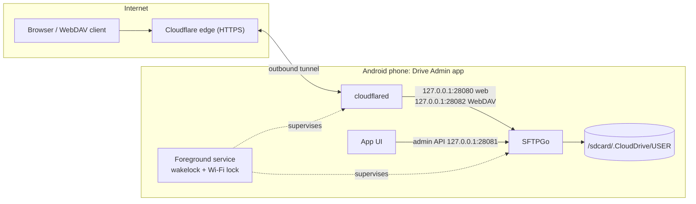

# Drive Admin (Android app)


A native app (Kotlin, Jetpack Compose, Material 3) that **runs the whole drive on the phone by
itself**, no Termux or other apps needed, and manages it. It can also manage an external SFTPGo
server such as the [Termux setup](setup.md).

| Mode | What runs where |
|---|---|
| **Built-in server** (recommended) | The app bundles SFTPGo (web drive, WebDAV, users, shares, quotas) and cloudflared, and runs them in a foreground service. Setup is a 3-step wizard. |
| **External server** | The app signs in to an SFTPGo admin API you run yourself (e.g. Termux), as in earlier versions. |

## Built-in server

### How it works



- **Users only through Cloudflare.** The web drive (`28080`) and WebDAV (`28082`) listen on
  `127.0.0.1` only, so the tunnel is the only way in. Optional **Home Wi-Fi access** (Settings) also
  serves them on the LAN over plain HTTP.
- **Admin only from the app.** SFTPGo's admin web panel is disabled everywhere. The admin REST API
  listens on its own loopback-only port (`28081`) that the tunnel never points at. The admin
  account is created on first start with a random 32-character password kept in the Android
  Keystore. You never see or type it. If it is ever lost (e.g. the Keystore was reset), the app
  recreates the admin account by itself. Users, shares and files are not affected.
- **No SFTP or FTP.** The built-in server deliberately serves only the web drive and WebDAV.
- **Stays up.** Foreground service (type `specialUse`) with a partial wakelock and a Wi-Fi lock;
  crashed processes restart with backoff (1 s up to 60 s). The tunnel reconnects at once when the
  phone switches networks. The server starts again after a reboot or an app update if it was
  running.
- **Brute-force protection** bans visitor IPs (the real IP from Cloudflare) after repeated failed
  logins. The phone itself (`127.0.0.1`) is on the safe list, so the app can never be locked out.

### Cloudflare connection

Settings → **Set up Cloudflare** (or step 2 of the wizard) offers two ways:

1. **Automatic:** create an API token in Cloudflare (*My Profile → API Tokens → Custom token*)
   with **Account › Cloudflare Tunnel › Edit**, **Zone › DNS › Edit** and **Zone › Zone › Read**.
   Paste it, pick your domain and the addresses (e.g. `drive.` and `dav.`), tap **Connect**. The app
   creates the tunnel `phone-cloud-drive`, its routes (including a 404 for `/web/admin` and `/api/`)
   and the DNS records. The API token is used only for this and is **not stored**; the app keeps
   only the tunnel token (Keystore-encrypted). Running it again updates the same tunnel.
2. **Tunnel token:** create the tunnel yourself in *Zero Trust → Networks → Tunnels*, add public
   hostnames pointing to `HTTP 127.0.0.1:28080` (drive) and `HTTP 127.0.0.1:28082` (WebDAV), and
   paste the token from the install command.

Use `127.0.0.1`, not `localhost`: on some phones `localhost` resolves to IPv6 `::1`, where nothing
listens.

### Phone settings

The wizard and the Home screen ask for these, with one-tap fixes:

| Setting | Why |
|---|---|
| **All files access** | Store the drive in the hidden `.CloudDrive` folder (or on an SD card) |
| **No battery limits** | Keep the server running with the screen off |
| **Notifications** (Android 13+) | Status notification with a **Stop** button |

Some manufacturers stop background apps on their own (Samsung: *Battery → Background usage limits →
Never sleeping apps*; Xiaomi: *Autostart* and *No restrictions*). On Android 12–13, if the server
is killed after a while, also see the [phantom process note](maintenance.md#troubleshooting).

### Ports

| Port (127.0.0.1) | Service |
|---|---|
| 28080 | Web drive (users) |
| 28081 | Admin REST API (this app only) |
| 28082 | WebDAV |
| 28083 | cloudflared metrics/readiness (used for the tunnel status) |

These are deliberately uncommon: other server apps on the phone often already use 8080. If a port
is taken anyway, the Home screen says which one.

### Files on the phone

```
/sdcard/.CloudDrive/<user>/                 drive files (Settings → Storage location to change)
/data/data/app.phoneclouddrive.admin/files/
├── sftpgo/sftpgo.db, signing.key           users, shares, quotas; session-signing key
├── sftpgo-ui/                              web templates (re-extracted when the app updates)
└── logs/sftpgo.log, cloudflared.log        rotated at 1 MB (also visible in the app)
```

## Features

- **Home:** server status and Start/Stop, public and home-Wi-Fi addresses (open/copy), live service
  status with logs, storage overview, a setup checklist
- **Users:** create, enable/disable, delete; storage limit (1/5/10/25/50 GB or none); access level
  (*Full access*, *Upload, no delete*, *View only*); change password; recalculate usage
- **Active:** current connections with protocol, IP, times and **Disconnect**
- **File browser:** per-user folders with photo/video thumbnails; **Open** a file in another app
  without making it public; **Save to phone** copies it to `Pictures|Movies|Music|Download/Drive`;
  **Delete**
- **Settings:** start after reboot, home Wi-Fi access, storage location, Cloudflare connection,
  **Sign out everywhere** (replaces the session-signing key), phone permissions, logs, mode switch
- **External server mode:** the earlier login screen with **Stay signed in** (password encrypted in
  the Keystore)

## Source layout

```
android/
├── native/build.sh                 # builds the bundled SFTPGo + cloudflared + web UI (see Build)
└── app/src/main/java/app/phoneclouddrive/admin/
    ├── MainActivity.kt             # theme, navigation, users, user detail, connections, login
    ├── HomeScreen.kt               # server status and controls
    ├── SettingsScreen.kt           # settings, logs viewer
    ├── CloudflareScreen.kt         # automatic / token tunnel setup
    ├── SetupScreen.kt              # first-run wizard
    ├── Components.kt, PhoneSetup.kt
    ├── AppViewModel.kt             # state and actions
    ├── SftpgoApi.kt                # SFTPGo admin REST client
    ├── SecureStore.kt              # Keystore-encrypted secrets
    ├── FilesScreen.kt, FileOps.kt  # file browser
    └── server/
        ├── ServerService.kt        # foreground service, health checks, boot receiver
        ├── Supervisor.kt           # runs/restarts the processes, logs
        ├── SftpgoConfig.kt         # SFTPGo settings (environment variables)
        ├── Cloudflare.kt           # Cloudflare API for automatic setup
        ├── ServerController.kt, ServerSettings.kt, ServerPaths.kt, UiInstaller.kt
```

## Build

Requirements: JDK 17+, the Android SDK (platform 35) **and NDK**, [Go](https://go.dev/dl) 1.26+,
git and `patch`. On Windows, run the shell script from Git Bash.

```sh
# 1. Build the bundled server (once, and again after changing versions or patches).
#    Downloads SFTPGo and cloudflared sources, cross-compiles them for Android, and packs
#    SFTPGo's web templates with this project's patches and theme.
bash android/native/build.sh     # arm64-v8a (almost every phone); "all" or "x86_64" for others

# 2. Build the app
cd android
./gradlew assembleRelease        # Windows: gradlew.bat assembleRelease
```

The APK is `android/app/build/outputs/apk/release/app-release.apk` (minified; signed with the
debug key, which is fine for personal sideloading. Add your own `signingConfigs` to publish). The
Gradle build stops with a clear message if step 1 hasn't been run.

Unit tests: `./gradlew testDebugUnitTest`.

Versions are pinned at the top of `native/build.sh` (`SFTPGO_VERSION`, `CLOUDFLARED_VERSION`). The
patches in `server/sftpgo/patches/` were made for SFTPGo 2.7.6; the script refuses to build if one
no longer applies.

## Install

```sh
adb install -r app/build/outputs/apk/release/app-release.apk
```

Or copy the APK to the phone and open it (allow installs from your file manager; Play Protect may
ask: **More details → Install anyway**).

## Permissions

| Permission | Why |
|---|---|
| `INTERNET`, `ACCESS_NETWORK_STATE`, `ACCESS_WIFI_STATE` | Serve the drive, run the tunnel, react to network changes, show the Wi-Fi address |
| `MANAGE_EXTERNAL_STORAGE` (All files access) | Store and browse the hidden drive folder |
| `READ/WRITE_EXTERNAL_STORAGE` (Android 10) | Same, on Android 10 |
| `FOREGROUND_SERVICE`, `FOREGROUND_SERVICE_SPECIAL_USE`, `WAKE_LOCK` | Keep the server running with the screen off |
| `RECEIVE_BOOT_COMPLETED` | Start again after a reboot |
| `POST_NOTIFICATIONS` | Status notification with Stop |
| `REQUEST_IGNORE_BATTERY_OPTIMIZATIONS` | Ask to run without battery limits |

`usesCleartextTraffic` is enabled because the app talks to its own server on `127.0.0.1` (or an
external server on the home LAN). Public traffic is HTTPS, terminated by Cloudflare.

## Limitations

- **Android 10 or newer** (the bundled programs must run from the app's native-library folder).
- **Starts after the first unlock** following a reboot, as before: Android keeps app data
  encrypted until then.
- **Upload size through Cloudflare** is limited to 100 MB per file on the free plan; the web drive
  warns before uploading larger files. Use home Wi-Fi access for bigger files.
- **No SFTP and no SSH shell** in built-in mode; use the Termux setup if you need them.
- **Updating SFTPGo or cloudflared** means rebuilding the app with new versions in `native/build.sh`.
