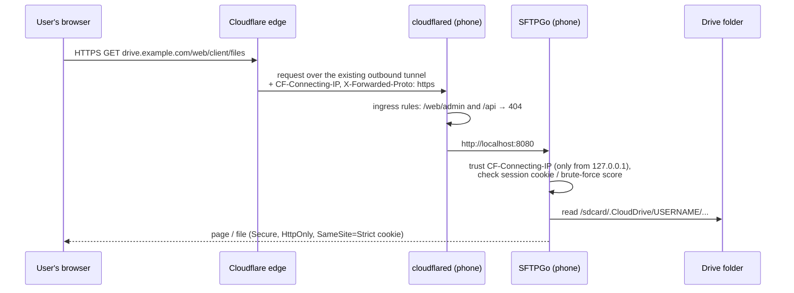
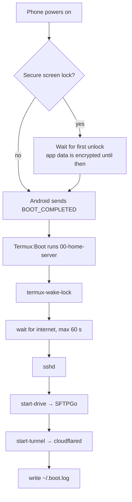

# Architecture

## Components

| Component | Runs where | Role |
|---|---|---|
| **Termux** | Phone (app) | Linux userland; hosts all server processes |
| **Termux:Boot** | Phone (app) | Runs `~/.termux/boot/00-home-server` after the first unlock following a boot |
| **SFTPGo** | Termux | Users, permissions, quotas, shares; web client + admin UI (HTTP :8080), WebDAV (:10080), SFTP (:2022); SQLite database |
| **Themed UI** | `~/sftpgo-ui` | SFTPGo's own templates + this project's patches, plus `drive.css`/logo via SFTPGo branding |
| **cloudflared** | Termux | Outbound tunnel to Cloudflare; maps public hostnames to local ports |
| **OpenSSH** | Termux | Remote shell for maintenance (:8022, home network) |
| **Drive Admin** | Phone (app) | Admin REST client and file browser |
| **Cloudflare** | Internet | DNS, TLS certificates, edge proxy for the tunnel |

## Request flow



## Boot sequence



## Sessions and authentication

- **Web client:** SFTPGo issues a JWT in an `HttpOnly`, `SameSite=Strict` cookie (also `Secure` when
  reached over HTTPS through the tunnel). It's signed with a key from
  `~/.sftpgo-signing.key`, so it stays valid across restarts. Lifetime is 12 h, renewed by SFTPGo
  when less than 6 h remain; the patched files page sends a keep-alive ping every 30 minutes while
  visible.
- **Logout** revokes the token in SFTPGo's in-memory list (see [security.md](security.md#known-limitations)).
- **WebDAV** uses HTTP basic auth per request (clients remember credentials).
- **Admin REST API:** short-lived bearer tokens from `/api/v2/token`; the Drive Admin app renews them
  automatically with the password kept in memory or, with *Stay signed in*, in the Keystore.
- **Brute-force protection** (SFTPGo "defender") scores failed logins per client IP and bans IPs
  that exceed the threshold.

## Data layout

```
/sdcard/.CloudDrive/            ← SFTPGO_DATA_PROVIDER__USERS_BASE_DIR (hidden, with .nomedia)
├── .nomedia
├── alice/                      ← each user's home directory (chroot)
└── bob/

$PREFIX/var/lib/sftpgo/sftpgo.db  ← users, admins, shares, quotas
~/sftpgo-ui/                       ← drive.env, templates/, static/
~/.cloudflared/                    ← tunnel credentials and config
```

## Web UI customisation approach

SFTPGo supports custom templates/static paths and branding (name, logo, favicon, extra CSS).
This project uses them as follows:

1. `install-ui.sh` copies the installed package's `templates/` and `static/` to `~/sftpgo-ui/`.
2. It applies four patches from `server/sftpgo/patches/`:

   | Patch | Change |
   |---|---|
   | `01-common-base` | Light-theme sidebar styles |
   | `02-common-baselogin` | Theme toggle on sign-in pages; hide the admin link off the home network |
   | `03-webclient-files` | Responsive file list; keep-alive; 95 MB public-upload guard; drop-anywhere upload; Enter/Escape for new folders; more media types; `playsinline` video |
   | `04-webclient-sharedownload` | Single-file shares download the original file instead of a zip |

3. It adds `static/drive/` (CSS, logo, favicon) referenced by the branding settings in `drive.env`.

The originals in `$PREFIX/share/sftpgo` stay untouched, so a package upgrade can't break the live
UI; re-running `install-ui.sh` rebuilds it.
