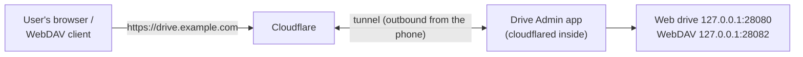

# Cloudflare setup for the Drive Admin app

This guide connects the app's **built-in server** to the internet through a Cloudflare Tunnel, so
users can reach the drive at `https://drive.example.com` (web) and `https://dav.example.com`
(WebDAV) from anywhere. No router ports are opened and your home IP stays hidden.

For the Termux setup, see [cloudflare-tunnel.md](cloudflare-tunnel.md) instead.

The app runs `cloudflared` itself. **You never install or run cloudflared on a computer.** The
Cloudflare dashboard only gives you a token; the app does the connecting.

## Before you start

- A domain whose DNS is on Cloudflare (free plan is fine). If it isn't yet, follow
  [step 1 of the Termux guide](cloudflare-tunnel.md#1-put-your-domain-on-cloudflare-dns).
- Drive Admin set up in built-in mode, with the server running (Home shows *Running*).

There are two ways. **Option A** needs only a few clicks in the dashboard and works for everyone.
**Option B** lets the app do the dashboard work but needs an API token with the right permissions.

---

## Option A: tunnel token (recommended)

### 1. Create the tunnel

1. Open [dash.cloudflare.com](https://dash.cloudflare.com) → **Networking → Tunnels** (older
   dashboards: **Zero Trust → Networks → Tunnels**).
2. Click **Create Tunnel**. If asked for a type, choose **Cloudflared**.
3. Name it, e.g. `phone-cloud-drive`, and click **Create Tunnel**.
4. The next page shows *Download and run cloudflared* with an operating-system picker and a
   command such as `cloudflared.exe service install eyJhIjoi…`.
   - **Don't download or run anything.**
   - Click the **copy** icon next to the command. The long `eyJ…` part is the tunnel token.
   - Keep this page open. *Connection Status* will say "Waiting for your Tunnel to connect…",
     which is expected until the next step.

### 2. Give the token to the app

Get the copied text to the phone, e.g. WhatsApp "Message yourself", an email or a notes app
(or open the dashboard in the phone's browser and copy it there).

In Drive Admin: **Settings → Set up Cloudflare → Tunnel token**:

| Field | Value |
|---|---|
| Tunnel token | Paste the whole copied command; the app extracts the token. |
| Drive address | `drive.example.com` |
| WebDAV address | `dav.example.com` (optional) |

Tap **Save and connect**. Within a minute Home shows **Online / Connected**, and on the Cloudflare
page *Connection Status* shows the connector and **Continue** becomes clickable.

> The token is a secret for this tunnel. The app stores it encrypted in the Android Keystore and
> passes it to cloudflared through its environment. Don't share it; if it leaks, use **Rotate token**
> on the tunnel's Overview page and paste the new one into the app.

### 3. Add the routes

Click **Continue** (or open the tunnel → **Routes** tab) → **Add route** → **Published
application**, and add:

| Subdomain | Domain | Path | Service URL |
|---|---|---|---|
| `drive` | `example.com` | *(empty)* | `http://127.0.0.1:28080` |
| `dav` | `example.com` | *(empty)* | `http://127.0.0.1:28082` |

If the form has a separate **Type**, choose **HTTP** and enter `127.0.0.1:28080` / `127.0.0.1:28082`.

Use `127.0.0.1`, not `localhost`: on some phones `localhost` resolves to IPv6 `::1`, where the
server doesn't listen.

Cloudflare creates the DNS records automatically. If it says a record already exists, see
[Old DNS records](#old-dns-records-error-1033).

Optional extra safeguard: add one more route for `drive` with **Path** `^/(web/admin|api/)` and
**Service URL** `http_status:404`, and move it **above** the plain `drive` route. The app already
disables these paths, so this is only a second layer.

### 4. Check it

Open `https://drive.example.com` and you should see the sign-in page. Then add users in the app
(**Users → Add user**).

---

## Option B: automatic setup with an API token

The app creates the tunnel (named `phone-cloud-drive`), its routes and the DNS records. The API
token is used only during setup and is **not stored**.

### 1. Create the API token

1. Cloudflare → profile icon → **My Profile → API Tokens → Create Token** → start from scratch
   (*Custom token*) and give it a name.
2. Permissions. In the current dashboard these are grouped in **policies**:
   - **Policy 1, type Account:** choose your account → **Cloudflare Tunnel → Edit**. In some
     dashboards it is listed as **Cloudflare One Connector: cloudflared → Edit**.
   - **Add new policy, type Zone:** choose your domain → **DNS → Edit** and **Zone → Read**.

   The account-level list **DNS & Zones** (DNS Firewall, DNS Settings, DNS Views, Registrar) is
   *not* what you need; the zone's DNS permission only appears inside a **Zone** policy.

   In the classic form the same thing is three rows:

   | | | |
   |---|---|---|
   | Account | Cloudflare Tunnel | Edit |
   | Zone | DNS | Edit |
   | Zone | Zone | Read |

   with *Zone Resources → Include → Specific zone → your domain*.
3. **Continue to summary → Create Token**, then copy it (it is shown only once).

### 2. Run it in the app

**Settings → Set up Cloudflare → Automatic** → paste the token → **Find my domains** → pick the
domain → keep or change `drive` / `dav` → **Connect**.

Running it again updates the same tunnel (e.g. to change the addresses). If an address already
has an `A`/`AAAA` record, the app stops and tells you instead of overwriting it.

---

## Moving from the Termux setup

A tunnel created by the Termux scripts (`setup-tunnel.sh`) is **locally managed**: its routes live
in `config.yml` on the phone. In the dashboard its routes are greyed out ("Routes are managed by a
local configuration file") and its old routes point to `localhost:8080` / `localhost:10080`.
Pasting its token into the app gives a tunnel without routes.

Either:

- **Migrate it:** on the tunnel's page (or in Zero Trust → Networks → Tunnels → the tunnel) choose
  **Migrate**, then edit the `drive` and `dav` routes to `http://127.0.0.1:28080` and
  `http://127.0.0.1:28082`, and paste its token into the app; **or**
- **Start fresh** (simplest):
  1. **Networking → Tunnels** → old tunnel → **⋯ → Delete**.
  2. Your domain → **DNS → Records**: delete (or later edit) the `drive` and `dav` CNAMEs that
     point to the old tunnel ID (`<old-id>.cfargotunnel.com`), plus any records of services you no
     longer run.
  3. Follow [Option A](#option-a-tunnel-token-recommended).

---

## Troubleshooting

### Old DNS records (error 1033)

`https://drive.example.com` shows **Error 1033** (HTTP 530): the hostname points to a tunnel that
isn't connected, usually an **old** tunnel.

Your domain → **DNS → Records** → find `drive` and `dav` (type CNAME) → their **Content** must be
`<new-tunnel-id>.cfargotunnel.com`. The tunnel ID is on the tunnel's Overview page (*Tunnel
details*). **Edit** the record, set the new target, keep **Proxied** (orange cloud) on and save. To
find the domain's records: account home → **Domains** → your domain → **DNS → Records** (or
press Ctrl+K and type the domain).

### Other problems

| What you see | Cause / fix |
|---|---|
| App: *Connecting…* for more than a minute | No internet on the phone, or the server is stopped. Check Home; open **Settings → Logs → Cloudflare tunnel log**. |
| App: *Cloudflare rejected the tunnel token* | The token was rotated or is incomplete. Copy it again from the tunnel's Overview page. |
| App: *This tunnel doesn't exist in Cloudflare* | The tunnel was deleted. Create a new one (Option A). |
| App: *Not a valid tunnel token* | The pasted text doesn't contain the `eyJ…` token. Copy the install command again. |
| Browser: **502 Bad Gateway** | A route's Service URL is wrong. It must be `http://127.0.0.1:28080` (drive) / `http://127.0.0.1:28082` (WebDAV). |
| Browser: **404** on the whole site | No route for this hostname on the tunnel; add it (step 3). |
| Cloudflare: *record already exists* when adding a route | Delete or edit the old DNS record first (see above). |
| Automatic setup: *Cloudflare rejected the API token* | Missing permission, or the token wasn't copied completely (see Option B step 1). |
| Uploads over 100 MB fail | Cloudflare free-plan limit per request. Turn on **Settings → Home Wi-Fi access** and upload at home via the address shown on Home. |
| Works on Wi-Fi but not after switching to mobile data | The app reconnects the tunnel automatically within seconds; if it doesn't, **Settings → Reconnect tunnel**. |

## What is reachable from the internet

| Address | Result |
|---|---|
| `https://drive.example.com` | Web drive and share links (login required) |
| `https://dav.example.com` | WebDAV (login required) |
| `https://drive.example.com/web/admin/…`, `/api/…` | **404**: the admin side exists only inside the app |
| Anything else on the phone | Not reachable; the tunnel only forwards the routes you add |

Optional: **Notifications → Add → Tunnel health alert** in Cloudflare emails you when the phone
goes offline.
